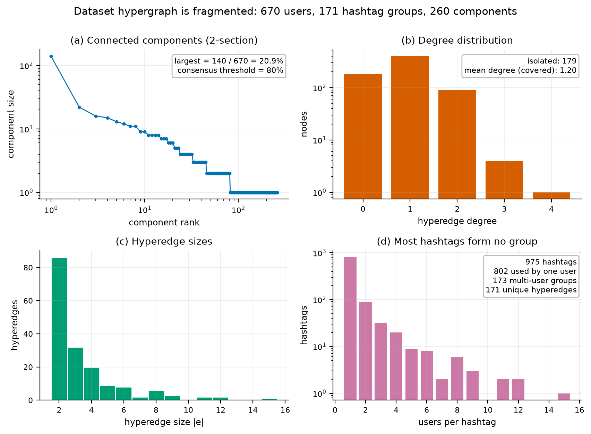

# Hypergraph–Nonlinear–Latency Voter Model

[](LICENSE)
[](pyproject.toml)
[](https://github.com/cxy2696/Hypergraph-Nonlinear-Latency-Voter-Model/actions/workflows/ci.yml)
[](CHANGELOG.md)

**中文** · [English](README_en.md) · [完整中文说明](README_cn.md)

A reproducible, tested reference implementation of the **Hybrid
Hypergraph–Nonlinear–Latency (HNL) voter model**, together with a controlled
re-analysis of the claims in the accompanying manuscript.

The model combines three ingredients: group interactions on a hypergraph,
nonlinear adoption of the local majority (exponent $q$), and heterogeneous
reaction delays (latencies $L_i$). v2 keeps the model family and fixes the
implementation, the statistics and the claims.

> **Headline result.** The nonlinear mechanism is real: on connected random
> hypergraphs, 80 % consensus is reached in **0 %** of runs at $q=0.5$ and in
> **87–100 %** of runs at $q=2.5$ (30 paired replicates). The latency claim is
> regime-dependent, oscillations are transient rather than sustained, and the
> Kaggle hashtag graph is too fragmented for a population-level consensus
> experiment: **0 of 900** dataset runs reach 80 %, and the model absorbs into a
> component-wise mosaic. Details and confidence intervals:
> [`docs/RESULTS.md`](docs/RESULTS.md).

## Quick start

```bash
git clone https://github.com/cxy2696/Hypergraph-Nonlinear-Latency-Voter-Model.git
cd Hypergraph-Nonlinear-Latency-Voter-Model
python -m venv .venv && source .venv/bin/activate
pip install -r requirements.txt

python -m pytest                        # 47 tests
python -m hnl.cli reproduce --root .    # ≈30 s: all experiments, tables, figures
```

A single run:

```bash
python -m hnl.cli simulate --q 1.5 --latency normal --sigma 2 --seed 42
```

Dataset diagnostics (fragmentation, components, coverage, sentiment mapping):

```bash
python -m hnl.cli diagnose --csv sentimentdataset.csv --scope full
```

## What v2 changes

| area | v1 | v2 |
|---|---|---|
| sentiment mapping | whitespace bug mapped every post to 1 | documented valence lexicon, 3 selectable mappings |
| real-world run | data opinions overwritten by random | `init="data"` and `init="random"` both reported |
| hyperedges | duplicate node ids and duplicate groups | deduplicated, validated |
| update rule | order-dependent, stale buffer | `node_mean` (order-independent, default), `node_sample`, literal `edge_sweep` |
| metrics | "oscillation" was the mean opinion | $O=\mathrm{sd}(\bar X(t))$, damping ratio, $T_c$, RMST |
| statistics | 10 runs, visual comparison | 30 paired replicates, bootstrap CIs, permutation tests, Holm, Kaplan–Meier |
| reproducibility | global RNG, no seeds, CLI flags documented but missing | explicit `SeedSequence` streams, argparse CLI, run manifest with hashes |
| tests / licence | none | 47 tests, MIT licence, CI |

The full audit, including the evidence for each item, is in
[`docs/ERRATA.md`](docs/ERRATA.md). The original prototype is preserved at tag
[`v1.0-legacy`](https://github.com/cxy2696/Hypergraph-Nonlinear-Latency-Voter-Model/tree/v1.0-legacy).

## Why the dataset result is structural

The hashtag hypergraph built from the shipped file has **260 connected
components** (81 after restricting to users with at least one hyperedge); the
largest component contains 20.9 % of all nodes and 28.5 % of the active
population. Since hyperedges
never cross components, the process cannot globally coordinate them. Its
absorbing states are the $2^C$ **component-wise mosaics**, not a single
consensus state (Proposition 1 in [`docs/MODEL.md`](docs/MODEL.md)). The
components do freeze internally (97.2 % of active components are unanimous at
the end of a run), which is why diversity "stabilises": it is an absorbing
mosaic, not a dynamical coexistence. This is why the population-level 80 %
threshold is the wrong target for this graph.



## Documentation

| document | content |
|---|---|
| [`docs/MODEL.md`](docs/MODEL.md) | formal model, three update rules, absorbing-state proposition, mean-field analysis |
| [`docs/ERRATA.md`](docs/ERRATA.md) | v1 defects, specification ambiguities, unsupported claims, data/bibliography issues |
| [`docs/DATA.md`](docs/DATA.md) | Kaggle provenance (CC0), schema, cleaning, valence lexicon, structural statistics, limitations |
| [`docs/RESULTS.md`](docs/RESULTS.md) | full re-analysis with tables, figures and a claim ledger |
| [`docs/REPRODUCIBILITY.md`](docs/REPRODUCIBILITY.md) | environment, seeds, commands, manifest, CI |
| [`results/TABLES.md`](results/TABLES.md) | all generated tables |
| [`HNL Voter Model.pdf`](https://cxy2696.github.io/Hypergraph-Nonlinear-Latency-Voter-Model/HNL%20Voter%20Model.pdf) | the original manuscript (unchanged) |

## Repository layout

```
hnl/                 package: engine, hypergraph, data, metrics, stats, experiments, plotting, CLI
tests/               47 unit/property tests
scripts/             supplementary long-horizon check
docs/                model specification, errata, data, results, reproducibility
results/             raw runs, trajectories, tables, manifest
figures/             generated figures (PNG + PDF)
model.py             backward-compatible v1 API
random_simulation.py, real_world_simulation.py   v1-compatible entry points
sentimentdataset.csv CC0 dataset (732 posts)
```

## Model in one paragraph

For a hypergraph $(V,E)$ with node weights $\alpha_i>0$ and opinions
$X_i\in\{0,1\}$, the influence score of opinion $x$ in group $e$ is
$S_x(e)=\sum_{j\in e}\alpha_j\mathbf 1[X_j=x]$, and the group adoption kernel is
$\pi_e=S_1^q/(S_0^q+S_1^q)$. A node aggregates the kernels of its incident
edges, updates only if it has waited at least $L_i$ sweeps since its last
change, and samples its new opinion from a Bernoulli law. See
[`docs/MODEL.md`](docs/MODEL.md) for the three aggregation rules, the exact
algorithm, and the proofs.

## Citation

```bibtex
@software{hnl_voter_model_2026,
  author  = {Cui, Xinyi and Yan, Leyi and Cai, Ruiying and Xiao, Chaowei},
  title   = {Hypergraph--Nonlinear--Latency Voter Model (v2.0.0)},
  year    = {2026},
  url     = {https://github.com/cxy2696/Hypergraph-Nonlinear-Latency-Voter-Model},
  note    = {Reference implementation and reproducibility package}
}
```

`CITATION.cff` is included for GitHub's "Cite this repository" button.

## Licence

MIT (see [`LICENSE`](LICENSE)). The dataset is CC0; see
[`docs/DATA.md`](docs/DATA.md).

## Scope

This is a research prototype for studying a model, not a forecasting tool. It
does not predict individuals or events and does not model recommendation,
media agenda, or offline behaviour. The manuscript PDF is the original
artifact; the v2 documents are a re-analysis, not a replacement paper.

The successor project [OpinionLab](https://github.com/cxy2696/opinionlab)
provides a service-oriented engine for applied work.
