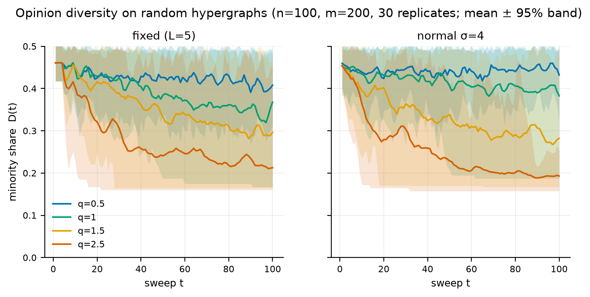
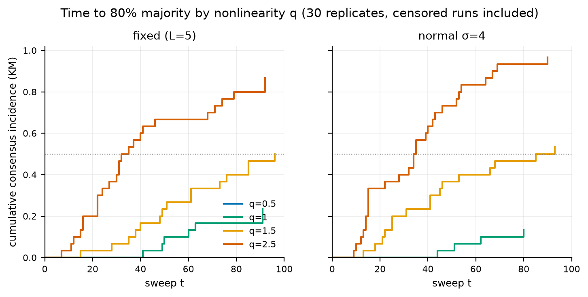
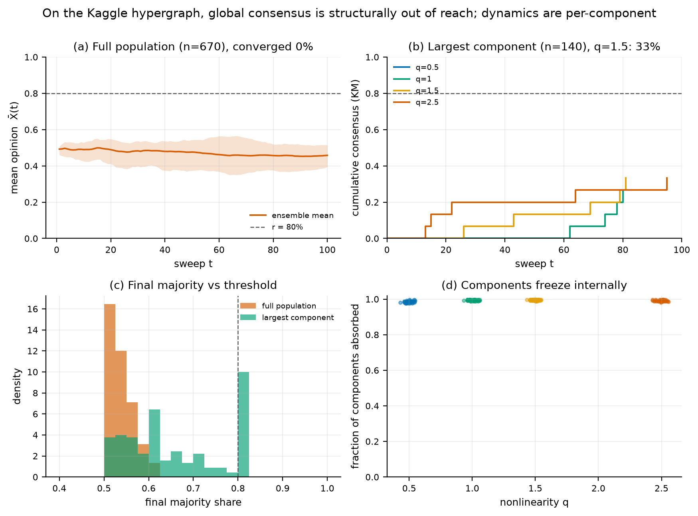

# 超图–非线性–时延 Voter 模型（v2.0.0）

[](LICENSE)
[](pyproject.toml)
[](https://github.com/cxy2696/Hypergraph-Nonlinear-Latency-Voter-Model/actions/workflows/ci.yml)

**中文** · [English](README_en.md) · [入口](README.md)

## 概述

本仓库是 **Hybrid Hypergraph–Nonlinear–Latency（HNL）Voter 模型** 的参考实现与可复现实验包。模型同时刻画三件事：

- 人们往往在**群体**中相互影响（超边），而不只是两两对话；
- 采纳概率对局部多数是**非线性**的，由指数 `q` 控制；
- 不同个体的**反应时延** `L_i` 不同。

v2 保留模型族本身，修正原型的实现与统计方法，并用一套带固定随机种子、配对设计的数值实验重新检验论文中的主张。原始论文 PDF 与 v1 脚本不做修改，v1 保存在标签 `v1.0-legacy`。

## 主要结论

完整证据、置信区间与全部表格见 [`docs/RESULTS.md`](docs/RESULTS.md)。

| 论文主张 | v2 结论 |
|---|---|
| `q` 越大，共识越快 | **成立**：`q=0.5` 时 0% 的运行达到 80% 多数，`q=2.5` 时 87–100%（30 个配对重复） |
| 时延方差越大，意见多样性维持越久 | **仅在 `q=0.5` 成立**：最终多样性 +0.024 至 +0.054；`q=1.5` 时在 Holm 校正后不显著 |
| 中等 `q` + 高时延方差产生持续振荡 | **不成立**：`O` 在 `q=2.5` 最高；后期/前期振幅比为 0.11–0.43 |
| `q` 越大，级联越大 | **方向相反**：最大单步级联从 0.43 降到 0.35 |
| 用社交媒体情感数据完成验证 | **不成立**：900 次数据实验中没有一次达到 80%；数据也没有纵向轨迹 |

一个新增的解析结果解释了数据上的现象：该过程的**吸收态是按连通分量各自一致的“马赛克”状态**，而不只是全局共识（[`docs/MODEL.md`](docs/MODEL.md) 命题 1）。因此，碎片化的超图会冻成马赛克，全人群共识并不是合适的目标。在随附的 hashtag 超图上（260 个连通分量，最大分量占 20.9%），在完整图、活跃图与数据初始化三种设置合计 900 次运行中，没有一次达到 80%，最大最终多数为 0.754。



## 本仓库是什么、不是什么

**是**：一个二元意见演化的随机模型、一个经过测试的实现、一套可复现的数值实验，以及对原型的逐条审计。

**不是**：对社交媒体的经验验证、预测工具、推荐系统或媒体议程模型，也不是论文的替代品。数据集提供的是群体结构，不是动态真值。

## 模型简述

对超图 `(V, E)`、节点权重 `α_i > 0` 与二元意见 `X_i`：

$$
S_x(e)=\sum_{j\in e}\alpha_j\,\mathbf 1[X_j=x],
\qquad
\pi_e=\frac{S_1(e)^q}{S_0(e)^q+S_1(e)^q}.
$$

节点把其所有关联超边的核按规则聚合（默认 `node_mean`），在 `t − T_i ≥ L_i` 时获得更新资格，并以 `X_i(t+1) ~ Bernoulli(P_i)` 采样新意见。三种聚合规则、精确算法、吸收态命题与平均场分析（`f'(1/2)=q`，在 `q=1` 处发生转变）见 [`docs/MODEL.md`](docs/MODEL.md)。

## 安装

```bash
git clone https://github.com/cxy2696/Hypergraph-Nonlinear-Latency-Voter-Model.git
cd Hypergraph-Nonlinear-Latency-Voter-Model
python -m venv .venv && source .venv/bin/activate
pip install -r requirements.txt
```

需要 Python ≥ 3.10；运行时只依赖 NumPy、pandas 与 matplotlib。也可以用 `pip install -e .` 安装为包。

## 使用

### 单次运行

```bash
python -m hnl.cli simulate --q 1.5 --latency normal --sigma 2 --seed 42
python -m hnl.cli simulate --preset dataset --scope active --init data --q 2.0
```

输出 JSON 摘要：共识时间、是否删失、最终多样性、振荡指数、级联规模、平均时延。

### Python API

```python
import numpy as np
from hnl import HNLVoterModel, ModelConfig
from hnl.hypergraph import random_hypergraph

hg = random_hypergraph(100, 200, (3, 6), np.random.default_rng(0))
cfg = ModelConfig(q=2.0, latency_dist="normal", mu=5, sigma=2,
                  consensus_threshold=0.8, max_steps=100)
result = HNLVoterModel.from_hypergraph(hg, cfg, seed=42).run()

print(result.consensus_time, result.censored, result.final_diversity)
print(result.oscillation_index, result.max_cascade)
```

### 复现论文式实验

```bash
python -m hnl.cli reproduce --root .          # 约 30 秒，完整 30 次重复设计
python -m hnl.cli reproduce --root . --quick  # 5 次重复，快速冒烟
```

输出 `results/`（原始运行、表格、清单）与 `figures/`（PNG + PDF）。

### 数据诊断

```bash
python -m hnl.cli diagnose --csv sentimentdataset.csv --scope full
```

报告用户数、超边数、覆盖率、连通分量、分量规模、情感映射覆盖率与结构性含义。

### 兼容 v1 的入口

```bash
python random_simulation.py --q 2.0 --latency_dist exponential --mu 5
python real_world_simulation.py --q 1.0 --init random --seed 42
```

`model.py` 仍暴露 v1 签名的 `HNLVoterModel`、`load_data` 与 `run_model_from_file`。

## 结果速览





* **非线性。** `q` 是模型中最稳健的部分。在连通的随机超图上，`q=0.5` 时 0% 的运行达到 80% 共识，`q=2.5` 时 87–100%；最终多样性的配对差为 −0.195 至 −0.282（Holm 校正后 `p = 3×10⁻⁴`，即置换检验的分辨率下限）。
* **时延。** 方差效应只在接近平衡时出现：`q=0.5` 时最终多样性增加 +0.024 至 +0.054；`q=1.5` 时所有对比在 Holm 校正后为零；`q=2.5` 时指数分布反而降低多样性。
* **振荡。** `O = sd(X̄(t))` 随 `q` 增大；`q=2.5` 时后期/前期振幅比降到 0.11–0.43。摆动是衰减的瞬态，不是极限环。
* **级联。** 高 `q` 下最大单步变化更小；低 `q` 让系统停留在接近 50/50 的位置，因此级联更大。
* **数据。** hashtag 图高度碎片化（260 个分量；最大分量占 20.9%）。900 次运行中 0 次达到 80%；分量内部冻结，稳定的多样性是吸收态马赛克。
* **更新规则。** 论文算法 1 的字面“逐边扫描”在 `T=100` 时 8 次运行中 0 次达到共识；`node_mean` 与 `node_sample` 在 `q≥1.5` 时达到 75–100%。在更小的图上逐边扫描最终也会吸收，但慢得多（中位数 25 对 10 步）。

## 测试与 CI

```bash
python -m pytest
```

47 个测试覆盖：采纳核、节点聚合、吸收态、时延门控、随机数可复现性、超边顺序不变性、指标（Kaplan–Meier、RMST、阻尼）、统计（自助法、置换检验、Holm）与数据管线。GitHub Actions 在每次推送时运行测试与一次快速复现。

## 数据

`sentimentdataset.csv` 是 Kaggle 的 *Social Media Sentiments Analysis Dataset*（Kashish Parmar，**CC0**），732 条帖子，空白规范化后 670 个用户标识，191 个情感标签。数据随仓库提供以保证可复现。情感→二元意见的映射记录在 [`docs/DATA.md`](docs/DATA.md)，它是建模选择，不是金标准。

## 文档

| 文档 | 内容 |
|---|---|
| [`docs/MODEL.md`](docs/MODEL.md) | 形式化定义、三种更新规则、命题、平均场 |
| [`docs/ERRATA.md`](docs/ERRATA.md) | v1 缺陷、规范歧义、不被支持的结论，逐条给出证据 |
| [`docs/DATA.md`](docs/DATA.md) | 数据来源、字段、清洗、词典、结构统计、局限 |
| [`docs/RESULTS.md`](docs/RESULTS.md) | 完整再分析与主张清单 |
| [`docs/REPRODUCIBILITY.md`](docs/REPRODUCIBILITY.md) | 种子、命令、环境、清单、CI |
| [`results/TABLES.md`](results/TABLES.md) | 全部生成表格 |
| [`HNL Voter Model.pdf`](https://cxy2696.github.io/Hypergraph-Nonlinear-Latency-Voter-Model/HNL%20Voter%20Model.pdf) | 原始论文 |
| [`paper/HNL_Voter_Model_v2.pdf`](paper/HNL_Voter_Model_v2.pdf) | 修订版：修正理论、配对实验与完整表格 |

## 引用

```bibtex
@software{hnl_voter_model_2026,
  author  = {Cui, Xinyi and Yan, Leyi and Cai, Ruiying and Xiao, Chaowei},
  title   = {Hypergraph--Nonlinear--Latency Voter Model (v2.0.0)},
  year    = {2026},
  url     = {https://github.com/cxy2696/Hypergraph-Nonlinear-Latency-Voter-Model},
  note    = {Reference implementation and reproducibility package}
}
```

## 许可与范围

代码采用 MIT 许可；数据采用 CC0。该模型是研究原型，不预测真实个体或事件。论文仍是原始成果；v2 文档是再分析，不是一篇新论文。

面向应用的服务化实现见后继项目 [OpinionLab](https://github.com/cxy2696/opinionlab)。
