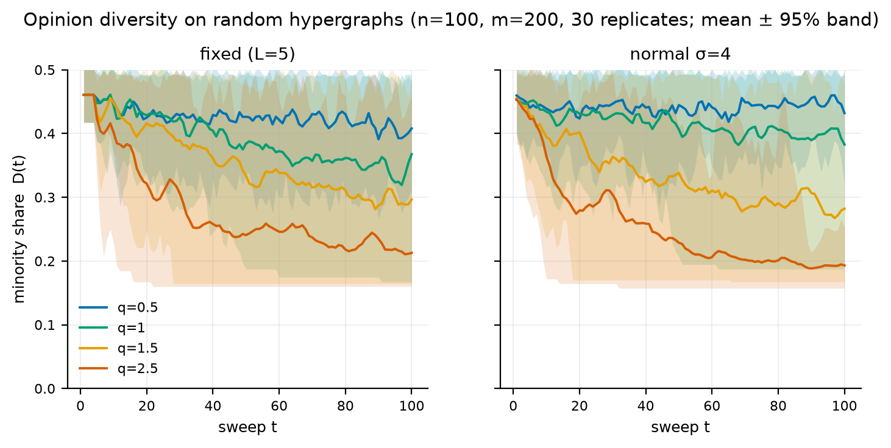
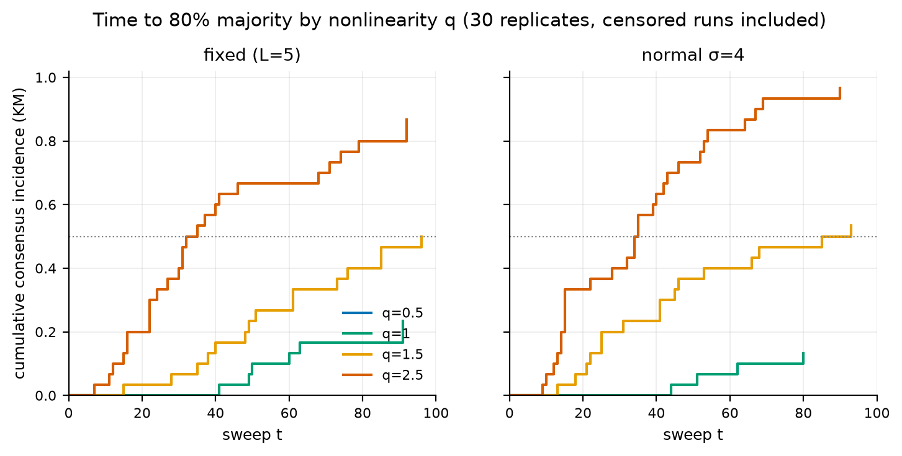
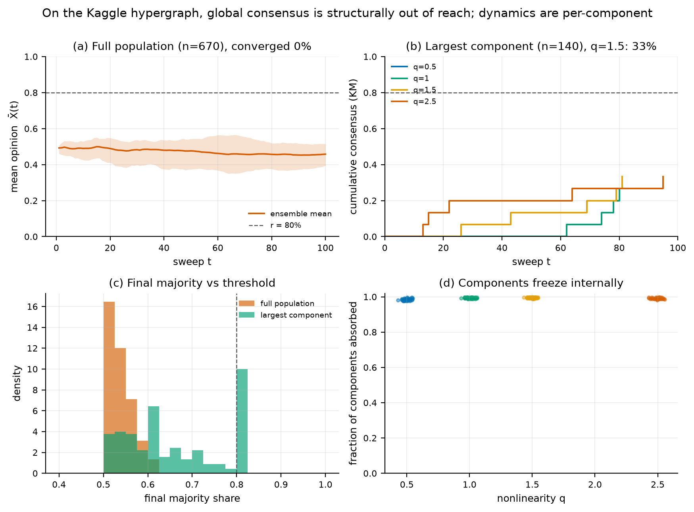

# Hypergraph–Nonlinear–Latency Voter Model (v2.0.0)

[](LICENSE)
[](pyproject.toml)
[](https://github.com/cxy2696/Hypergraph-Nonlinear-Latency-Voter-Model/actions/workflows/ci.yml)

**English** · [中文](README_cn.md) · [index](README.md)

## Overview

This repository is the reference implementation and reproducibility package for
the **Hybrid Hypergraph–Nonlinear–Latency (HNL) voter model**. The model asks
how opinions spread when people influence each other in groups (hyperedges),
when adoption is a nonlinear function of the local majority (exponent `q`), and
when different people react after different delays (`L_i`).

Version 2 keeps the model family but fixes the prototype and re-examines its
claims with a controlled, fully seeded design. The original manuscript PDF and
the v1 scripts are preserved (tag `v1.0-legacy`); they are not modified.

## Headline findings

The full evidence, with confidence intervals and all tables, is in
[`docs/RESULTS.md`](docs/RESULTS.md).

| manuscript claim | v2 verdict |
|---|---|
| Higher `q` accelerates consensus | **supported**: 0 % consensus at `q=0.5` vs 87–100 % at `q=2.5` (30 paired replicates) |
| High latency variance prolongs diversity | **only at `q=0.5`**: +0.024 to +0.054 final diversity; null at `q=1.5` |
| Moderate `q` + high variance produces sustained oscillations | **not supported**: `O` is highest at `q=2.5`; late/early amplitude ratio 0.11–0.43 |
| Higher `q` produces larger cascades | **opposite**: max cascade falls from 0.43 to 0.35 |
| Validation on social-media sentiment data | **not supported**: 0 of 900 dataset runs reach 80 %; no longitudinal data |

A new analytical result explains the dataset findings: the absorbing states of
the process are **component-wise consensus states**, not only global consensus
(Proposition 1 in [`docs/MODEL.md`](docs/MODEL.md)). A fragmented hypergraph
therefore freezes into a mosaic; population-wide consensus is not the right
target. On the shipped hashtag graph (260 components, largest 20.9 % of nodes),
the model reaches 80 % in none of the 900 runs across the full, active and
data-initialised variants, and the largest final majority is 0.754.



## What this repository is — and is not

**Is:** a stochastic model of binary opinion change, a tested implementation,
a set of reproducible numerical experiments, and a documented audit of the
original prototype.

**Is not:** an empirical validation on social media, a forecasting tool, a
model of recommendation or media effects, or a replacement for the manuscript.
The dataset supplies a group structure, not a ground truth.

## Model in brief

For a hypergraph `(V, E)`, node weights `α_i > 0`, and binary opinions `X_i`:

$$
S_x(e)=\sum_{j\in e}\alpha_j\,\mathbf 1[X_j=x],
\qquad
\pi_e=\frac{S_1(e)^q}{S_0(e)^q+S_1(e)^q}.
$$

A node aggregates the kernels of its incident hyperedges (`node_mean` by
default), is eligible when `t − T_i ≥ L_i`, and samples
`X_i(t+1) ~ Bernoulli(P_i)`. The three aggregation rules, the exact algorithm,
the absorbing-state proposition and the mean-field analysis (`f'(1/2)=q`, a
transition at `q=1`) are in [`docs/MODEL.md`](docs/MODEL.md).

## Install

```bash
git clone https://github.com/cxy2696/Hypergraph-Nonlinear-Latency-Voter-Model.git
cd Hypergraph-Nonlinear-Latency-Voter-Model
python -m venv .venv && source .venv/bin/activate
pip install -r requirements.txt
```

Python ≥ 3.10; NumPy, pandas and matplotlib are the only runtime dependencies.
The package can also be installed with `pip install -e .`.

## Usage

### Single run

```bash
python -m hnl.cli simulate --q 1.5 --latency normal --sigma 2 --seed 42
python -m hnl.cli simulate --preset dataset --scope active --init data --q 2.0
```

The command prints a JSON summary (consensus time, censoring flag, final
diversity, oscillation index, cascade size, mean latency).

### Python API

```python
import numpy as np
from hnl import HNLVoterModel, ModelConfig
from hnl.hypergraph import random_hypergraph

hg = random_hypergraph(100, 200, (3, 6), np.random.default_rng(0))
cfg = ModelConfig(q=2.0, latency_dist="normal", mu=5, sigma=2,
                  consensus_threshold=0.8, max_steps=100)
result = HNLVoterModel.from_hypergraph(hg, cfg, seed=42).run()

print(result.consensus_time, result.censored, result.final_diversity)
print(result.oscillation_index, result.max_cascade)
```

### Reproduce the paper-style study

```bash
python -m hnl.cli reproduce --root .          # ≈30 s, full 30-replicate design
python -m hnl.cli reproduce --root . --quick  # 5 replicates, smoke test
```

This writes `results/` (raw runs, tables, manifest) and `figures/` (PNG + PDF).

### Dataset diagnostics

```bash
python -m hnl.cli diagnose --csv sentimentdataset.csv --scope full
```

Reports users, hyperedges, coverage, connected components, component sizes,
sentiment-mapping coverage and a structural implication.

### Backward-compatible v1 entry points

```bash
python random_simulation.py --q 2.0 --latency_dist exponential --mu 5
python real_world_simulation.py --q 1.0 --init random --seed 42
```

`model.py` still exposes `HNLVoterModel`, `load_data` and
`run_model_from_file` with the v1 signatures.

## Results at a glance





* **Nonlinearity.** The `q` effect is the robust part of the model. On connected
  random hypergraphs, 80 % consensus is reached in 0 % of runs at `q=0.5` and
  87–100 % at `q=2.5`; the paired difference in final diversity is −0.195 to
  −0.282 (Holm-adjusted `p = 3×10⁻⁴`, the permutation resolution floor).
* **Latency.** The variance effect is real only near balance: at `q=0.5` it
  adds +0.024 to +0.054 final diversity; at `q=1.5` all contrasts are null
  after Holm; at `q=2.5` the exponential distribution reduces diversity.
* **Oscillations.** `O = sd(X̄(t))` grows with `q`, and the late/early amplitude
  ratio falls to 0.11–0.43 at `q=2.5`. Swings are damped transients, not limit
  cycles.
* **Cascades.** The largest single-sweep change is smaller at high `q`; low `q`
  keeps the system near balance and produces larger cascades.
* **Dataset.** The hashtag graph is fragmented (260 components; largest 20.9 %
  of nodes). 0 of 900 runs reach 80 %; components freeze internally; the
  stable diversity is an absorbing mosaic.
* **Update rule.** The literal edge sweep of the manuscript's Algorithm 1
  reaches consensus in 0 of 8 runs at `T=100`, while `node_mean` and
  `node_sample` reach it in 75–100 % at `q≥1.5`. On a smaller graph the edge
  sweep does absorb, but much more slowly (median 25 vs 10 sweeps).

## Tests and CI

```bash
python -m pytest
```

47 tests cover the kernel, node aggregation, absorbing states, latency gating,
RNG reproducibility, edge-order invariance, metrics (Kaplan–Meier, RMST,
damping), statistics (bootstrap, permutation, Holm) and the dataset pipeline.
GitHub Actions runs the tests and a quick reproduction on every push.

## Data

`sentimentdataset.csv` is the Kaggle *Social Media Sentiments Analysis
Dataset* (Kashish Parmar, **CC0**), 732 posts, 670 user identifiers after
whitespace normalisation, 191 emotion labels. It is included for
reproducibility. The sentiment → binary opinion mapping is documented in
[`docs/DATA.md`](docs/DATA.md); it is a modelling choice, not a gold standard.

## Documentation

| document | content |
|---|---|
| [`docs/MODEL.md`](docs/MODEL.md) | formal specification, three update rules, propositions, mean-field |
| [`docs/ERRATA.md`](docs/ERRATA.md) | every v1 defect and every unsupported claim, with evidence |
| [`docs/DATA.md`](docs/DATA.md) | provenance, schema, cleaning, lexicon, structural statistics, limits |
| [`docs/RESULTS.md`](docs/RESULTS.md) | full re-analysis and claim ledger |
| [`docs/REPRODUCIBILITY.md`](docs/REPRODUCIBILITY.md) | seeds, commands, environment, manifest, CI |
| [`results/TABLES.md`](results/TABLES.md) | all generated tables |
| [`HNL Voter Model.pdf`](https://cxy2696.github.io/Hypergraph-Nonlinear-Latency-Voter-Model/HNL%20Voter%20Model.pdf) | original manuscript |
| [`paper/HNL_Voter_Model_v2.pdf`](paper/HNL_Voter_Model_v2.pdf) | revised edition: corrected theory, paired experiments, full tables |

## Citation

```bibtex
@software{hnl_voter_model_2026,
  author  = {Cui, Xinyi and Yan, Leyi and Cai, Ruiying and Xiao, Chaowei},
  title   = {Hypergraph--Nonlinear--Latency Voter Model (v2.0.0)},
  year    = {2026},
  url     = {https://github.com/cxy2696/Hypergraph-Nonlinear-Latency-Voter-Model},
  note    = {Reference implementation and reproducibility package}
}
```

## Licence and scope

MIT for the code; CC0 for the dataset. The model is a research prototype and
does not predict real individuals or events. The manuscript remains the
original artifact; the v2 documents are a re-analysis, not a new paper.

The successor project [OpinionLab](https://github.com/cxy2696/opinionlab)
provides a service-oriented engine for applied work.
