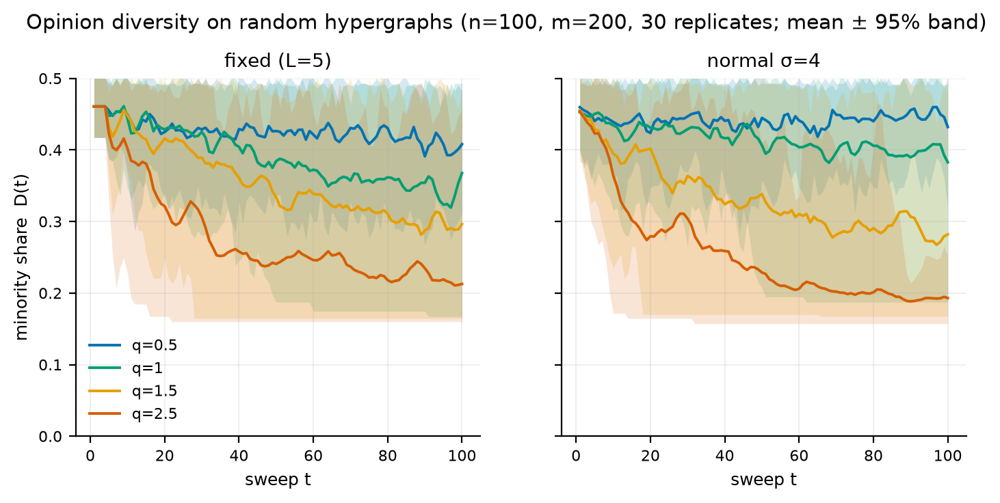
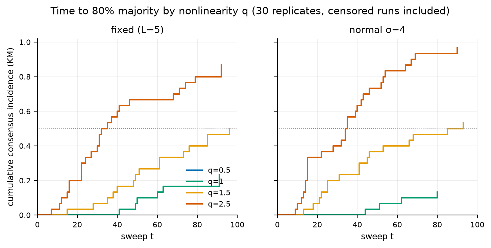
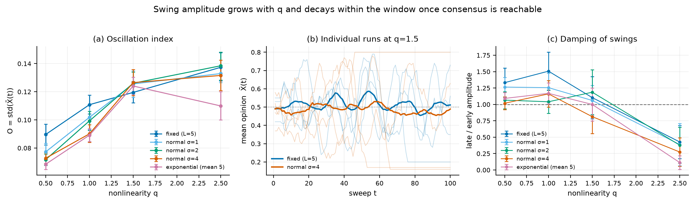
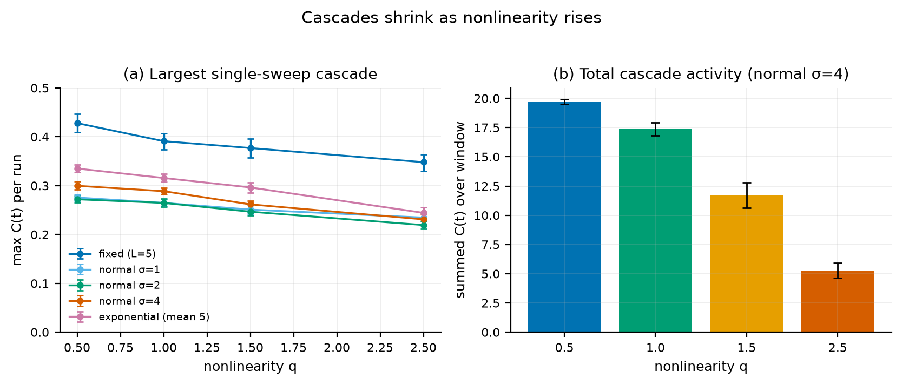
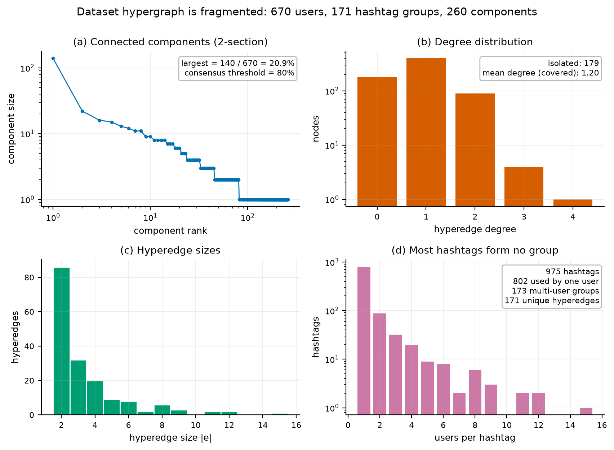
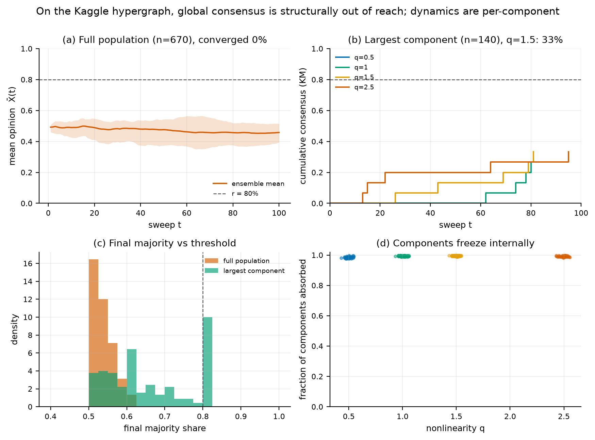
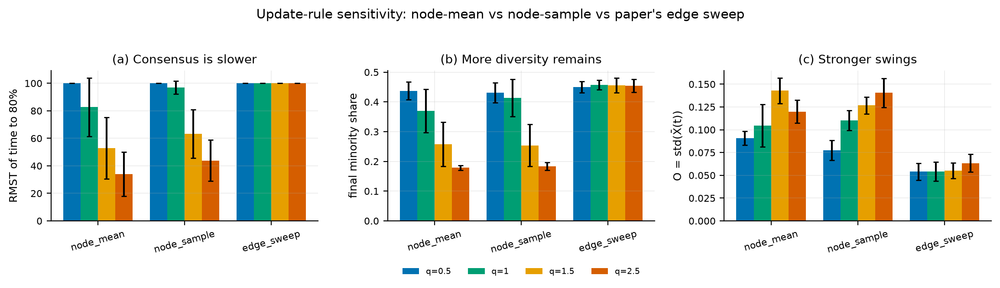

# Results of the v2 re-analysis

> **Status.** Exploratory re-analysis of the model family, not a preregistered
> study and not an empirical validation. Every number below is produced by
> `python -m hnl.cli reproduce` from the seeds and files in this repository;
> the full tables are in [`results/TABLES.md`](../results/TABLES.md) and the
> raw runs in [`results/`](../results). A revised manuscript that synthesises
> these results is [`paper/HNL_Voter_Model_v2.pdf`](../paper/HNL_Voter_Model_v2.pdf).
> The original manuscript PDF is unchanged; this
> document reports what the model actually does under a controlled design.

## 1. Claim ledger

| manuscript claim | verdict | evidence |
|---|---|---|
| Higher $q$ accelerates consensus | **supported** | §3; $\Delta$ final diversity $-0.195$ to $-0.282$, consensus rate $+0.87$ to $+1.00$ |
| High latency variance prolongs diversity | **only at $q=0.5$** | §4; $\Delta D=+0.024$ to $+0.054$ at $q=0.5$; null at $q=1.5$ |
| Moderate $q$ + high variance → sustained oscillations | **not supported** | §5; $O$ is highest at $q=2.5$; late/early ratio 0.11–0.43 at $q=2.5$ |
| Higher $q$ → larger cascades | **opposite** | §6; max $C$ falls from 0.43 to 0.35 (fixed latency) |
| Real-world validation on social-media sentiment | **not supported** | §7; 0 / 900 dataset runs reach 80 %; no longitudinal data |
| Diversity stabilises | **reinterpreted** | §7; it is an absorbing component-wise mosaic, not dynamic coexistence |

## 2. Design and inference

**Random hypergraphs.** $n=100$ nodes, $m=200$ hyperedges, edge sizes uniform
on $\{3,\dots,6\}$, node weights $\alpha_i\sim\max(0.1,\mathcal N(1,0.2^2))$.
Grid: $q\in\{0.5,1.0,1.5,2.5\}$ × latency $\in$ {fixed $L=5$,
$\mathcal N(5,1^2)$, $\mathcal N(5,2^2)$, $\mathcal N(5,4^2)$,
exponential mean 5}; 30 replicates; $T=100$; $r=0.8$; `node_mean`.

**Common random numbers.** Each replicate draws one hypergraph, one initial
opinion vector and one vector of uniforms. Latencies for every distribution
are obtained from the same uniforms by inverse CDF, and every $(q,\text{latency})$
cell runs on that replicate. All contrasts are therefore paired: a difference
compares the same graph, initial condition and latency quantiles.

**Inference.** Percentile bootstrap 95 % CIs (2 000 resamples), two-sided paired
sign-flip permutation tests (10 000 permutations), Holm adjustment within each
latency stratum, Cliff's $\delta$ as effect size. Consensus times are
right-censored at $T$; cells are summarised by the Kaplan–Meier estimator and
the restricted mean survival time $\mathrm{RMST}(T)$.

**Dataset.** The Kaggle hashtag hypergraph (see [`DATA.md`](DATA.md)) with
`active` scope (491 users), 30 replicates; `full` (670 users), 15 replicates;
largest component (140 users), 15 replicates; and the active graph with
data-derived initial opinions, 15 replicates.

## 3. Nonlinearity accelerates consensus and reduces diversity





**Table 1.** Random hypergraphs, 30 replicates per cell.

| latency | $q$ | P(consensus) | KM median $T_c$ | RMST | final $D$ | $O$ | max $C$ |
|---|---:|---:|---:|---:|---:|---:|---:|
| exponential | 0.5 | 0.000 | — | 100.000 | 0.462 | 0.068 | 0.335 |
| exponential | 1.0 | 0.067 | ∞ | 97.844 | 0.407 | 0.089 | 0.316 |
| exponential | 1.5 | 0.500 | ∞ | 75.070 | 0.306 | 0.124 | 0.296 |
| exponential | 2.5 | 1.000 | 21.000 | 26.048 | 0.180 | 0.110 | 0.244 |
| fixed | 0.5 | 0.000 | — | 100.000 | 0.408 | 0.090 | 0.428 |
| fixed | 1.0 | 0.233 | ∞ | 91.444 | 0.368 | 0.111 | 0.391 |
| fixed | 1.5 | 0.500 | ∞ | 77.997 | 0.296 | 0.120 | 0.377 |
| fixed | 2.5 | 0.867 | 35.000 | 46.519 | 0.213 | 0.137 | 0.348 |
| normal $\sigma=1$ | 0.5 | 0.000 | — | 100.000 | 0.448 | 0.077 | 0.276 |
| normal $\sigma=1$ | 1.0 | 0.100 | ∞ | 97.150 | 0.372 | 0.102 | 0.265 |
| normal $\sigma=1$ | 1.5 | 0.400 | ∞ | 79.976 | 0.306 | 0.126 | 0.251 |
| normal $\sigma=1$ | 2.5 | 0.967 | 41.000 | 40.074 | 0.187 | 0.133 | 0.235 |
| normal $\sigma=2$ | 0.5 | 0.000 | — | 100.000 | 0.445 | 0.072 | 0.272 |
| normal $\sigma=2$ | 1.0 | 0.067 | ∞ | 95.430 | 0.401 | 0.099 | 0.265 |
| normal $\sigma=2$ | 1.5 | 0.600 | 93.000 | 78.503 | 0.261 | 0.126 | 0.247 |
| normal $\sigma=2$ | 2.5 | 0.900 | 32.000 | 41.853 | 0.212 | 0.138 | 0.219 |
| normal $\sigma=4$ | 0.5 | 0.000 | — | 100.000 | 0.432 | 0.073 | 0.300 |
| normal $\sigma=4$ | 1.0 | 0.133 | ∞ | 94.648 | 0.383 | 0.090 | 0.289 |
| normal $\sigma=4$ | 1.5 | 0.533 | 93.000 | 69.759 | 0.282 | 0.127 | 0.262 |
| normal $\sigma=4$ | 2.5 | 0.967 | 35.000 | 36.951 | 0.193 | 0.132 | 0.231 |

The transition is sharp and monotone. At $q=0.5$ **no run in any latency
condition** reaches 80 % within 100 sweeps; at $q=2.5$ the consensus rate is
87–100 %. Diversity at the horizon falls accordingly, and the RMST of the time
to consensus falls from the censoring ceiling (100) to 26–47 sweeps.

**Table 2.** Paired contrasts $q=2.5$ vs $q=0.5$ (Holm-adjusted).

| latency | metric | $\Delta$ | 95 % CI | $p$ | Cliff $\delta$ |
|---|---|---|---:|---:|---:|
| exponential | final $D$ | −0.282 | [−0.298, −0.265] | 0.0003 | −1.00 |
| fixed | final $D$ | −0.195 | [−0.222, −0.166] | 0.0003 | −0.89 |
| normal $\sigma=1$ | final $D$ | −0.261 | [−0.281, −0.241] | 0.0003 | −1.00 |
| normal $\sigma=2$ | final $D$ | −0.233 | [−0.262, −0.196] | 0.0003 | −0.90 |
| normal $\sigma=4$ | final $D$ | −0.239 | [−0.258, −0.219] | 0.0003 | −0.99 |
| exponential | P(consensus) | +1.000 | [+1.000, +1.000] | 0.0003 | 1.00 |
| fixed | P(consensus) | +0.867 | [+0.733, +0.967] | 0.0003 | 0.87 |
| normal $\sigma=1$ | P(consensus) | +0.967 | [+0.900, +1.000] | 0.0003 | 0.97 |
| normal $\sigma=2$ | P(consensus) | +0.900 | [+0.767, +1.000] | 0.0003 | 0.90 |
| normal $\sigma=4$ | P(consensus) | +0.967 | [+0.900, +1.000] | 0.0003 | 0.97 |

The minimum attainable Holm-adjusted $p$ with 10 000 permutations and three
comparisons is $3\times10^{-4}$; the entries at that value are the resolution
floor, not a precise estimate.

This is the part of the manuscript that the data support most clearly, and it
also agrees with the mean-field picture in [`MODEL.md`](MODEL.md) §6.3: the
symmetric state is unstable for $q>1$, so connected populations drift to one
consensus state, while $q<1$ slows absorption.

## 4. Latency variance: a small low-$q$ effect, not a general law

**Table 3.** Final diversity relative to fixed latency (paired, Holm-adjusted).

| $q$ | latency | $\Delta$ final $D$ | 95 % CI | $p$ | Cliff $\delta$ |
|---|---:|---:|---|---:|---:|
| 0.5 | exponential | +0.054 | [+0.029, +0.076] | 0.0012 | 0.63 |
| 0.5 | normal $\sigma=1$ | +0.040 | [+0.018, +0.063] | 0.0064 | 0.45 |
| 0.5 | normal $\sigma=2$ | +0.037 | [+0.018, +0.058] | 0.0057 | 0.42 |
| 0.5 | normal $\sigma=4$ | +0.024 | [+0.001, +0.046] | 0.0477 | 0.28 |
| 1.5 | exponential | +0.010 | [−0.056, +0.079] | 1.0000 | 0.02 |
| 1.5 | normal $\sigma=1$ | +0.010 | [−0.045, +0.065] | 1.0000 | 0.09 |
| 1.5 | normal $\sigma=2$ | −0.036 | [−0.097, +0.026] | 1.0000 | −0.21 |
| 1.5 | normal $\sigma=4$ | −0.014 | [−0.075, +0.043] | 1.0000 | −0.08 |

At $q=0.5$ every non-degenerate latency distribution leaves significantly more
minority share at the horizon than fixed latency, but the effect is small
($\le0.054$, versus $\le0.282$ for the $q$ contrast). At $q=1.5$ the estimates
are centred on zero and the CIs exclude any effect larger than about 0.08. At
$q=2.5$ the exponential distribution is associated with **less** diversity
($\Delta=-0.033$, $p=0.036$), and the consensus-rate contrasts are all
non-significant after Holm.

The manuscript's general statement — "high latency variance prolongs
diversity" — is therefore not supported. The defensible statement is narrower:
*at low nonlinearity, where the population is near balance, heterogeneous
delays slightly slow the decay of the minority*. The dominant driver in the
design is $q$, not $\sigma$.

## 5. Oscillations are transient and grow with $q$



**Table 4.** Early vs late swing amplitude, $O=\mathrm{sd}(\bar X(t))$.

| latency | $q$ | early $O$ | late $O$ | ratio | $\Delta$ later−earlier | 95 % CI | $p$ |
|---|---:|---:|---:|---:|---:|---|---:|
| fixed | 0.5 | 0.079 | 0.096 | 1.33 | +0.017 | [+0.004, +0.029] | 0.017 |
| fixed | 1.0 | 0.093 | 0.118 | 1.51 | +0.025 | [−0.001, +0.048] | 0.061 |
| fixed | 1.5 | 0.116 | 0.102 | 1.10 | −0.014 | [−0.049, +0.020] | 0.435 |
| fixed | 2.5 | 0.151 | 0.052 | 0.43 | −0.099 | [−0.131, −0.065] | 0.0001 |
| normal $\sigma=4$ | 0.5 | 0.073 | 0.071 | 1.02 | −0.002 | [−0.010, +0.005] | 0.655 |
| normal $\sigma=4$ | 1.0 | 0.085 | 0.087 | 1.16 | +0.002 | [−0.016, +0.019] | 0.826 |
| normal $\sigma=4$ | 1.5 | 0.128 | 0.081 | 0.81 | −0.047 | [−0.084, −0.010] | 0.022 |
| normal $\sigma=4$ | 2.5 | 0.140 | 0.031 | 0.27 | −0.108 | [−0.140, −0.075] | 0.0001 |

(Full table, including the $\sigma=1,2$ and exponential rows, in
[`results/TABLES.md`](../results/TABLES.md) §4.)

Three observations:

1. $O$ **increases** with $q$ (paired $q=2.5$ vs $q=0.5$: $+0.041$ to $+0.067$,
   $p<0.001$), rather than peaking at the "moderate" value $q=1.5$.
2. At $q=2.5$ the late-window amplitude is 11–43 % of the early amplitude: the
   swings are strongly damped as consensus is reached.
3. At $q=1.5$ the late/early ratio is 0.81–1.19 across latency specifications.
   That is consistent with slow, partially damped motion over a 100-sweep
   window, not with a validated sustained oscillation. In particular, high
   latency variance does **not** raise $O$ at $q=1.5$:
   $\Delta O=+0.007$ (95 % CI $[-0.005,+0.020]$, $p=0.885$) for $\sigma=4$
   versus fixed.

Proposition 1 in [`MODEL.md`](MODEL.md) explains the third point: the process
is a finite absorbing chain, so a sustained oscillation cannot persist
asymptotically. A refractory period can generate a damped wave, and high $q$
makes the wave larger before absorption; it cannot generate a limit cycle.

## 6. Cascades shrink as nonlinearity rises



The largest single-sweep change is **smaller** at high $q$, not larger. With
fixed latency it falls from 0.428 at $q=0.5$ to 0.348 at $q=2.5$ (paired
$\Delta=-0.080$, $p<0.001$); the same ordering holds for every latency
specification, and the total cascade activity over the window falls from 19.7
to 5.3 (normal $\sigma=4$, panel b). The mechanism is visible in Table 1: low
$q$ keeps the population near balance, where a single sweep can flip a large
fraction; high $q$ reaches consensus early, after which there is little left
to flip. The manuscript's statement that high $q$ produces "more frequent and
larger" cascades is therefore reversed for this metric: low $q$ produces the
larger and more persistent cascade activity.

## 7. The dataset: a fragmented mosaic, not a consensus experiment



**Table 5.** Structural statistics of the hashtag hypergraph.

| scope | nodes | edges | coverage | isolated | components | largest | largest share | mean \|e\| | mean degree |
|---|---:|---:|---:|---:|---:|---:|---:|---:|---:|
| full | 670 | 171 | 73.3 % | 179 | 260 | 140 | 20.9 % | 3.46 | 1.20 |
| active | 491 | 171 | 100 % | 0 | 81 | 140 | 28.5 % | 3.46 | 1.20 |
| largest component | 140 | 45 | 100 % | 0 | 1 | 140 | 100 % | 4.16 | 1.34 |



**Table 6.** Consensus at $r=0.8$ on the dataset hypergraph.

| scope | runs | P(consensus) | mean final $D$ | components absorbed | max final majority |
|---|---:|---:|---:|---:|---:|
| active (random init) | 600 | **0.000** | 0.449 | 0.972 | 0.754 |
| full (random init) | 180 | **0.000** | 0.463 | 0.991 | 0.613 |
| active (data init) | 120 | **0.000** | 0.383 | 0.984 | 0.743 |
| largest component | 180 | 0.250 | 0.343 | — | 0.821 |

Across all 900 population-level runs the 80 % threshold is **never** reached;
the largest final majority observed is 0.754. The components nevertheless
absorb internally: 97.2 % of active-graph components are unanimous at the end
of a run, and 99.1 % in the full graph. This is exactly the mosaic predicted by
Proposition 1: each component freezes, and the global minority is the mass of
components that froze on the other colour. The "stabilisation of diversity" in
the manuscript is therefore an absorbing state, not a dynamical coexistence.

$q$ has little effect on this population-level outcome: paired contrasts on
final diversity in the active graph lie between $-0.034$ and $+0.009$; only one
of the fifteen contrasts (normal $\sigma=4$, $q=1.5$: $\Delta=-0.034$,
$p=0.040$) is significant after Holm, and its effect is small. The reason is
structural: once the graph is fragmented, the global majority is determined by
how the components break, not by the within-component convergence speed. The
$q$ effect reappears where it should — inside the largest component
($\sigma=4$: $\Delta D=-0.095$ to $-0.133$, $p=0.009$ to $0.002$;
$\sigma=2$: $-0.101$ to $-0.167$, $p=0.026$ to $0.0003$) and in the
data-initialised active graph at $q\ge1.5$ ($\Delta D=-0.066$ to $-0.128$,
$p\le0.006$) — but even there it does not produce population-wide consensus.

## 8. The update rule is a first-order modelling choice



**Table 7.** Update-rule sensitivity (random hypergraph, normal $\sigma=2$,
8 replicates, $T=100$).

| rule | $q$ | P(consensus) | RMST | final $D$ | $O$ |
|---|---:|---:|---:|---:|---:|
| `edge_sweep` | 0.5 | 0.000 | 100.000 | 0.450 | 0.054 |
| `edge_sweep` | 1.0 | 0.000 | 100.000 | 0.457 | 0.054 |
| `edge_sweep` | 1.5 | 0.000 | 100.000 | 0.456 | 0.055 |
| `edge_sweep` | 2.5 | 0.000 | 100.000 | 0.455 | 0.063 |
| `node_mean` | 0.5 | 0.000 | 100.000 | 0.438 | 0.091 |
| `node_mean` | 1.0 | 0.250 | 82.758 | 0.370 | 0.105 |
| `node_mean` | 1.5 | 0.750 | 52.833 | 0.257 | 0.143 |
| `node_mean` | 2.5 | 1.000 | 34.067 | 0.179 | 0.120 |
| `node_sample` | 0.5 | 0.000 | 100.000 | 0.431 | 0.078 |
| `node_sample` | 1.0 | 0.125 | 97.003 | 0.414 | 0.110 |
| `node_sample` | 1.5 | 0.750 | 63.374 | 0.254 | 0.127 |
| `node_sample` | 2.5 | 1.000 | 43.846 | 0.184 | 0.141 |

The three rules agree at $q=0.5$ (nothing reaches consensus) and diverge
sharply at high $q$. The literal edge sweep of Algorithm 1 reaches consensus
in **0 of 8** runs at every $q$; the node-centric rules reach it in 75–100 % of
runs at $q\ge1.5$. The edge sweep is not non-absorbing: on a smaller graph
($n=30$, $m=60$, 5 seeds, up to 20 000 sweeps) it absorbs in 14–146 sweeps,
versus 7–36 for `node_mean` and 6–18 for `node_sample`
([`results/edge_sweep_longrun.csv`](../results/edge_sweep_longrun.csv)). It is
much slower at $n=100$ because a node that does not change keeps being offered
updates on later incident edges, while a node that changes is blocked for its
latency period; the last-wins rule then reinforces the status quo. The
manuscript's Algorithm 1 is therefore not equivalent to the intended
node-centric process, and the choice of rule must be reported. v2 makes the
order-independent `node_mean` the default and keeps the literal sweep for
comparison.

## 9. What survives, what does not

**Survives.** The core nonlinear mechanism: a $q>1$ kernel amplifies the local
majority, and on a connected hypergraph this produces a sharp, monotone
increase in consensus speed and a matching collapse of diversity. The
qualitative mean-field transition at $q=1$ is visible in the simulation.

**Does not survive as stated.** The claims that latency variance generally
prolongs diversity, that moderate $q$ plus high variance produces sustained
oscillations, that high $q$ produces larger cascades, and that the Kaggle
sentiment data validate the dynamics. The first two are regime-dependent or
null; the third is reversed; the fourth is structurally impossible on the
shipped graph.

**New.** The absorbing set is component-wise (Proposition 1). This turns the
dataset result from a puzzle into a prediction: a fragmented hashtag graph must
produce a mosaic, and the 80 % consensus criterion is not a property of the
opinion dynamics but of the graph's component structure.

## 10. Limitations of this re-analysis

* **Exploratory.** The hypotheses were not preregistered; the $q$ and $\sigma$
  grids are coarse; the design uses one random-graph family and one dataset.
* **Power.** With 30 paired replicates, the 95 % CI for a final-diversity
  contrast is roughly $\pm0.03$–$0.05$. Null results for latency at $q=1.5$
  mean "no effect larger than about 0.08 was detected", not "the effect is
  exactly zero".
* **Multiple comparisons.** Holm is applied within each latency stratum, not
  across the whole document; the claim ledger should be read as a summary of
  effect sizes and intervals, not as a family-wise error-controlled audit of
  every row.
* **Model scope.** Static hypergraph, static weights, no external shocks,
  binary opinions, no edge rewiring. Adding any of these could change the
  latency and cascade results.
* **Dataset.** 732 posts, 617 single-post users, no trajectory; the sentiment
  mapping is a documented but coarse projection. The dataset result is a
  structural statement, not a validation.
* **Implementation.** Floating-point results can differ in the last bits across
  BLAS/CPU versions; seeds and version pins are recorded in the manifest.

## 11. Reproducibility

```bash
python -m pytest                     # 54 checks
python -m hnl.cli reproduce --root . # ~30 s; writes results/ and figures/
python -m hnl.cli diagnose --csv sentimentdataset.csv --scope full
```

The manifest [`results/manifest.json`](../results/manifest.json) records the
git commit, Python/NumPy/pandas/matplotlib versions, all design parameters, the
dataset SHA-256 and the SHA-256 of every generated artifact. See
[`REPRODUCIBILITY.md`](REPRODUCIBILITY.md) for the full protocol.
